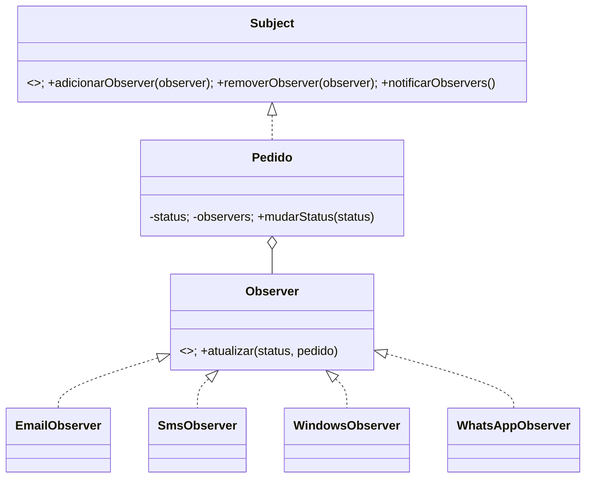

# Laboratory Observer

## O que e o padrao Observer

Observer e um padrao comportamental que define uma relacao de um-para-muitos entre objetos. Um objeto chamado `Subject` mantem uma lista de interessados, os `Observers`, e os notifica quando seu estado muda. Assim, o Subject nao precisa conhecer os detalhes de cada interessado: basta que todos sigam a mesma interface de notificacao.

### Como funciona

1. Os observers interessados se inscrevem no subject.
2. Quando ocorre uma mudanca relevante, o subject percorre os observers inscritos e envia a notificacao, normalmente com o novo estado ou os dados necessarios para reagir.
3. Cada observer executa sua propria acao. Ele tambem pode cancelar a inscricao quando nao precisar mais receber notificacoes.

Neste projeto, `Pedido` e o Subject: ao mudar de status, notifica os observers de e-mail, SMS, Windows e WhatsApp. Cada canal reage de forma independente, sem que `Pedido` precise conhecer a implementacao dos servicos de notificacao.

### Vantagens

- Reduz o acoplamento entre o objeto que muda de estado e os objetos que reagem a essa mudanca.
- Permite adicionar ou remover observers sem alterar o Subject, desde que respeitem a interface definida.
- Mantem cada reacao em uma classe propria, facilitando a organizacao e os testes.
- Permite que varios interessados reajam ao mesmo evento.

### Desvantagens

- A ordem e o momento das notificacoes podem ser dificeis de acompanhar quando ha muitos observers.
- Uma falha ou demora em um observer pode afetar a notificacao dos seguintes se o fluxo for sincrono e nao houver isolamento de erros.
- Inscricoes esquecidas podem manter observers ativos por mais tempo que o necessario, causando efeitos duplicados ou consumo desnecessario de recursos.
- O fluxo de execucao fica menos direto: uma mudanca pode disparar efeitos em varias partes do sistema.

### Quando usar

Use o Observer quando uma mudanca em um objeto precisar avisar um ou mais componentes, e esses componentes puderem variar ou ser adicionados independentemente. Ele e especialmente util em eventos de dominio, interfaces reativas e sistemas de notificacao multicanal.

Evite-o quando houver poucos interessados e uma chamada direta for mais simples, quando a ordem das reacoes precisar ser estritamente controlada, ou quando o volume e a confiabilidade das notificacoes exigirem uma fila de mensagens ou outro mecanismo assíncrono dedicado.

## Aplicacao

Aplicacao de pedidos baseada no padrao Observer, com CRUD de produtos, autenticacao por papel e notificacao multicanal.

## Executar

```text
npm.cmd install
copy .env.example .env
npm.cmd run build
npm.cmd test
npm.cmd start

Remove-Item -Recurse -Force .baileys-auth Caso o QR Code no terminal não apareça
```

Acesse `http://localhost:3000`. Na tela de login, use `Criar uma conta`.

Durante o desenvolvimento, execute a API e o frontend em terminais separados:

```text
npm.cmd run dev:api
npm.cmd run dev
```

O frontend fica em `http://localhost:5173` e as rotas são `/login`, `/cadastro` e `/dashboard`.

## Laboratorio Observer

O exemplo didatico solicitado no PDF esta separado da aplicacao web em `examples/observer`. Ele demonstra as interfaces comportamentais `Observer` e `Subject`, o `Pedido` como Subject concreto, os observers de e-mail, SMS, log e WhatsApp, a remocao de um observer e um segundo pedido com outra configuracao.

Execute com:

```text
npm.cmd run example:observer
```

No cadastro, o checkbox marcado cria um usuário `DONO`; desmarcado cria um `FUNCIONARIO`. Funcionários podem criar pedidos e alterar status, mas não gerenciam produtos. Donos podem criar, consultar, editar e excluir produtos, além de acompanhar e alterar pedidos.

## Regras de acesso

- Funcionario: cria pedidos, consulta pedidos e altera status.
- Dono: gerencia produtos, pedidos e status; recebe as notificacoes por e-mail, SMS, Windows e WhatsApp.

## Arquitetura

`Pedido` e o Subject e conhece somente a interface comportamental dos observers. Cada canal e um Observer separado, e cada integracao externa fica atras de um provider. Assim, a troca de status dispara todos os canais sem acoplar o dominio a Google, Infobip, Windows ou Baileys.



## Banco

O modelo em `sql/schema.sql` separa usuarios, produtos, pedidos e historico de status. As chaves estrangeiras preservam a origem do pedido e de cada transicao. Execute esse script em MySQL antes de iniciar a aplicacao. Se o banco ja existia, execute tambem `sql/migrations/001_add_quantidade_pedido.sql`. Usuarios, produtos e pedidos sao persistidos no banco.

As credenciais das APIs ficam somente no `.env`: SMTP do e-mail, chave Infobip e numero autenticado do Baileys. Sem essas variaveis, os providers retornam `skipped` para permitir desenvolvimento e testes sem chamadas externas. Para Gmail, use uma senha de aplicativo em `EMAIL_PASSWORD`. Mantenha `EMAIL_TLS_REJECT_UNAUTHORIZED=true`; desativar essa validação só deve ser usado temporariamente para diagnosticar um certificado interceptado por antivírus/proxy.

As notificacoes de e-mail e WhatsApp usam `OWNER_EMAIL` e `OWNER_PHONE`; quando ausentes, usam `EMAIL_USER` e `WHATSAPP_NUMBER` como fallback. O destino do SMS pode ser definido separadamente em `INFOBIP_SMS_TO` (em formato internacional, sem `+`, por exemplo `5512996637203`); se ausente, o SMS usa `OWNER_PHONE` e depois `WHATSAPP_NUMBER`.

Para SMS, `INFOBIP_SMS_SENDER` precisa ser um remetente aprovado na conta Infobip. Em uma conta Trial/Free, o número de destino também precisa estar cadastrado e verificado na lista de destinatários de teste da Infobip; isso é uma regra da conta e não pode ser feito pela API da aplicação. A API pode aceitar a mensagem e entregar depois; confirme o `messageId`, o `status` e o relatório de entrega no painel da Infobip quando o aparelho nao receber o SMS.